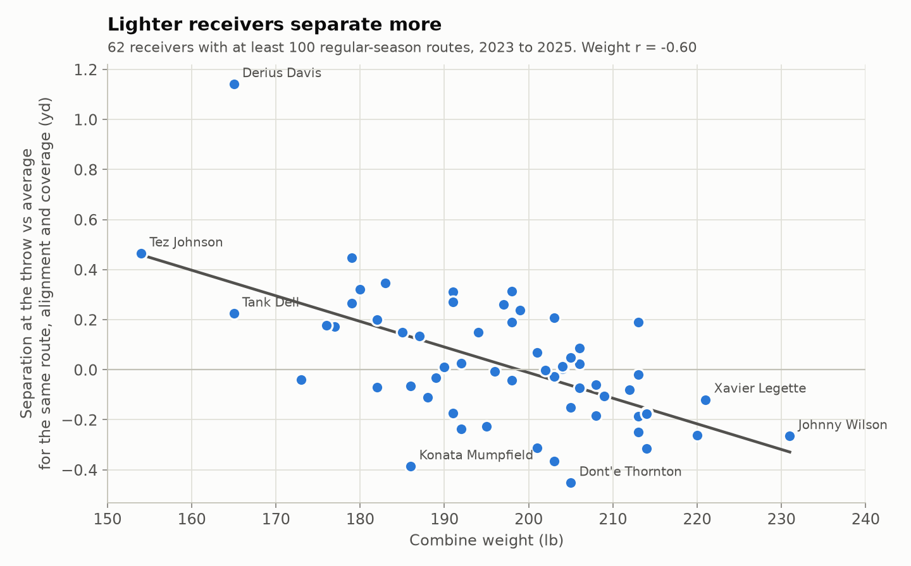
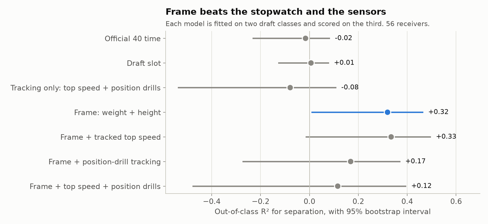
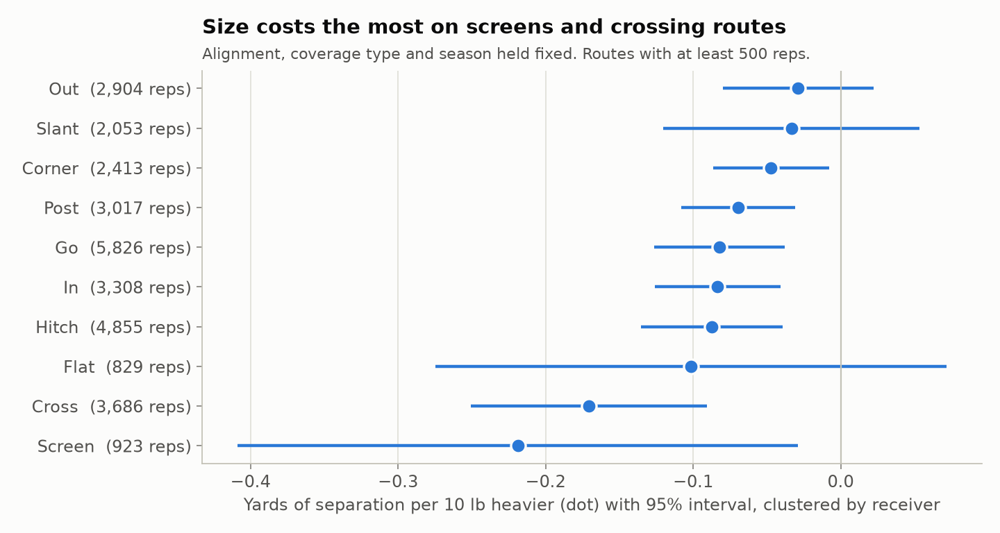
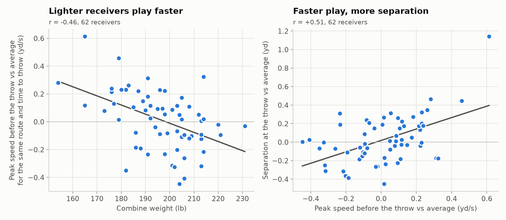
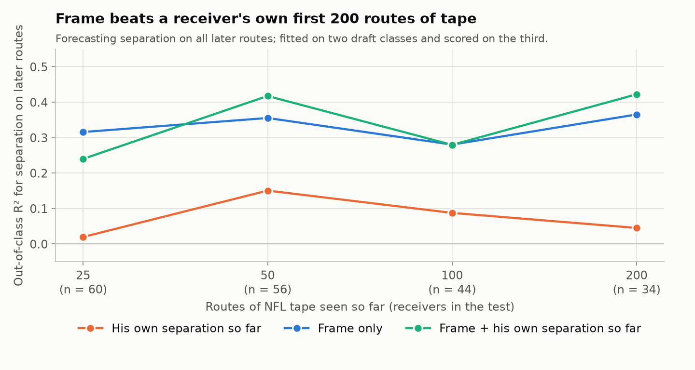
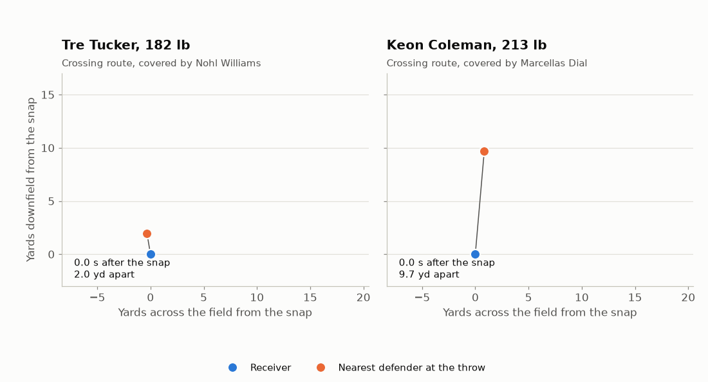

# Frame First: What the Combine Can and Cannot Tell You About a Receiver's Separation

**NFL Big Data Bowl 2027, Open Track**
**Notebook:** [NFL BDB 2027: Frame First](https://www.kaggle.com/code/willrice/nfl-bdb-2027-frame-first). Every number and figure below is printed or drawn by that notebook.

Thank you to the NFL and Kaggle for pairing Combine tracking with three seasons of game data. Thanks to @tombliss for confirming how ball rows are labelled, to @yumekohata for documenting how the three Combine exports differ, and to @dariushafshar, whose tracking audit set the bar for checking a metric before believing it.

## Summary

Which Combine measurements say how open a rookie receiver will get? For 62 receivers from the 2023 to 2025 classes, the answer is the scale and the tape measure. Weight and height predict separation in a draft class the model never saw (out-of-class R² 0.34). The official 40 time and draft slot predict none of it. Tracked top speed adds almost nothing, and the 10 Hz position drills make the forecast worse, because a single drill rep repeats poorly. Game tracking shows why frame matters: on the same route with the same time to throw, lighter receivers reach a higher speed before the ball comes out. That play speed is where tracked Combine speed does help. In season, frame forecasts a receiver's later separation better than his own first 200 routes of tape.

## Data and outcome

The play table records the distance to the nearest defender at the throw on every route a receiver runs, not only on targets. That is 30,566 regular-season route reps by 82 wide receivers, of which 6,433 were targets.

Raw separation depends on the job a receiver is given. Each rep is therefore compared with the average for the same route, alignment, coverage type and season. A receiver's mean difference is his role-adjusted separation. The cohort is the 62 receivers with at least 100 routes: 28, 19 and 15 by draft class, with a median of 354 routes.

The outcome is a stable trait. Random halves of a receiver's reps agree at r = 0.84 for raw separation and 0.69 after role adjustment. After adjustment, receivers differ by a standard deviation of 0.26 yards.

## Validation

Every predictive claim is scored leave-one-draft-class-out: fit on two classes, predict the third, for each class in turn. It is the only test on players the model has not seen. With 62 players the intervals are wide, so we report bootstrap intervals over receivers and a permutation test.

## Frame predicts separation

_Figure 1. Combine weight against role-adjusted separation. Labels mark the two lightest, two heaviest, two most open and two least open receivers._

Heavier and taller receivers separate less. Weight correlates with role-adjusted separation at r = -0.60 and height at -0.53. Fitted together, ten more pounds at a fixed height costs 0.079 yards and one more inch at a fixed weight costs 0.020.

Out of class, weight and height explain 0.338 of the variance (95% interval 0.07 to 0.48, permutation p = 0.001). Each class is predicted from the other two at r = 0.61, 0.45 and 0.72.

_Table 1. The frame result under other choices. R² is leave-one-draft-class-out._

| Sample                              | Receivers | Out-of-class R² | Weight r | Height r |
| :---------------------------------- | --------: | --------------: | -------: | -------: |
| At least 100 routes, role-adjusted  |        62 |            0.34 |    -0.60 |    -0.53 |
| At least 100 routes, raw separation |        62 |            0.34 |    -0.57 |    -0.56 |
| At least 50 routes                  |        68 |            0.24 |    -0.56 |    -0.49 |
| At least 150 routes                 |        56 |            0.36 |    -0.61 |    -0.54 |
| At least 200 routes                 |        44 |            0.31 |    -0.66 |    -0.58 |
| Rookie season only                  |        52 |            0.21 |    -0.56 |    -0.42 |
| Without the largest outlier         |        61 |            0.27 |    -0.56 |    -0.49 |

## What the stopwatch and the sensors add

_Figure 2. Out-of-class R² for role-adjusted separation from seven sets of Combine information, on the same 56 receivers who have a timed and tracked 40._

The official 40 time scores -0.016 and draft slot 0.006. Frame scores 0.320. Adding tracked top speed moves it to 0.334. Adding the position-drill tracking drops it to 0.169, and tracking with no frame scores -0.079.

The drills fail because single reps do not repeat. We smoothed speed, differenced it, took each rep's peak braking, peak re-acceleration and top speed, and standardized within drill and draft class. Across a prospect's reps, split-half reliability is 0.19 for braking, 0.51 for re-acceleration and 0.44 for top speed, over 1,529 reps of 15 drills. None adds to frame (p = 0.61 to 0.86).

## Where size costs the most

_Figure 3. Yards of separation per ten pounds of receiver weight, by route, with alignment, coverage type and season held fixed. Intervals are clustered by receiver._

Over all routes, ten more pounds costs 0.086 yards. The cost is largest on screens (-0.219) and crossing routes (-0.170). It is smallest on slants (-0.033) and outs (-0.029), where the interval includes zero. It is twice as large against zone coverage (-0.100) as against man (-0.050), and larger out wide (-0.095) than in the slot (-0.062).

Defenses also give heavier receivers less room. Cushion at the snap shrinks 0.083 yards per ten pounds. Holding cushion fixed moves the separation slope only from -0.085 to -0.072, so cushion carries about 15% of it.

## Why: play speed

_Figure 4. Left: weight against play speed. Right: play speed against separation. Play speed is peak speed between snap and throw, relative to the average for the same route, alignment, coverage type, season and time to throw._

Game tracking follows 29,704 of those reps from snap to throw, with a median time to throw of 2.7 s. Play speed is among the most stable traits in the data, with split-half reliability of 0.86.

On the same route with the same time to throw, ten more pounds means a peak speed 0.063 yd/s lower. Across receivers, play speed correlates with weight at -0.46 and with separation at +0.51. Frame and play speed together explain 0.45 of separation in sample, against 0.37 for frame alone, and the weight coefficient's t-value falls from -2.85 to -1.43. Play speed carries part of the frame effect.

This is where Combine tracking earns its place. Out of class, tracked top speed predicts play speed (R² +0.150) and the official 40 time does not (-0.037). With frame added, the scores are +0.278 and +0.128.

## In season: frame against tape

_Figure 5. Forecasting a receiver's separation on all later routes after his first 25, 50, 100 and 200 career routes. The test has 60, 56, 44 and 34 receivers._

A receiver's own separation so far forecasts his later separation with out-of-class R² of 0.02, 0.15, 0.09 and 0.05 at the four checkpoints. Frame alone scores 0.32, 0.36, 0.28 and 0.37. Both together score 0.24, 0.42, 0.28 and 0.42. The tape is not noise: it correlates with later separation at +0.31 to +0.42. Frame is simply the stronger signal for a long time.

Across 40 pairs of consecutive seasons from 29 receivers, role-adjusted separation repeats at r = +0.38. The part beyond the frame expectation repeats at +0.17 (p = 0.29). The frame expectation predicts next season's separation at +0.55.

## Two typical reps

_Figure 6. One crossing route each for a lighter and a heavier receiver, from snap to throw, with the nearest defender._

The tracking follows only the rookie cohort, so most plays show no defender. On 465 crossing routes a second tracked rookie is the recorded nearest defender, confirmed because his tracked distance at the throw matches the recorded separation within 0.15 yards. Receivers of 190 lb or lighter had a median separation of 3.20 yards on those reps. Receivers of 210 lb or heavier had 2.14.

The animation shows the rep closest to each group's median among reps thrown after 2.5 to 3.0 s: Tre Tucker (182 lb) at 3.26 yards from Nohl Williams, and Keon Coleman (213 lb) at 2.14 yards from Marcellas Dial. The pair is typical by construction. It is an illustration, not evidence.

## The same pattern in the trenches

For 78 defensive linemen, NFL get-off time correlates with Combine weight at +0.71 and with hoop-drill peak speed at -0.53. With weight in the model, hoop speed adds nothing detectable (p = 0.24).

For 58 offensive linemen, pressure probability allowed is highly repeatable (0.84). It is unrelated to weight (+0.11), draft slot (-0.16) or any position-drill metric (-0.01 to +0.08). Line-drill braking and re-acceleration barely repeat (0.01 and 0.20).

## What did not hold

- **Position-drill tracking as a predictor.** It lowers out-of-class accuracy. One rep per drill is not a measurement of a trait.
- **A separation-over-frame grade.** What is left after frame does not persist from season to season (+0.17), so ranking receivers on it would rank noise.
- **Tracked speed as a role projector.** Faster receivers run more go, post and corner routes in sample (r = +0.29), but the relation fails out of class (R² -0.044).
- **Our earlier outcome.** Scoring only targeted breaking routes discarded most of the reps.

## How a team can use this

1. **Read separation against frame.** A heavy receiver with average separation is beating his expectation. A light one is not.
2. **Build the route tree by frame.** Size costs the least on slants and outs and against man coverage. It costs the most on screens, crossers and against zone.
3. **Be slow to trust early tape.** For a rookie's first 200 routes, frame says more about his later separation than his separation so far. Blending the two helped from about 50 routes.
4. **Use tracked 40 speed for play speed.** It beats the official time there, and play speed is what the frame effect runs through.
5. **Record two reps per position drill.** Until reps repeat, the drills cannot be graded.

## Limits

The cohort is 62 receivers from three classes, all of whom made a roster and ran routes. Separation is not production: a receiver can win at the catch point or after it. Role adjustment cannot see route depth, leverage or the defender's quality. Frame and play speed are correlated traits on the same players, so the play-speed result describes a pathway, not a cause.

## Code

- Notebook: [kaggle.com/code/willrice/nfl-bdb-2027-frame-first](https://www.kaggle.com/code/willrice/nfl-bdb-2027-frame-first)
- Repository, with tests that run the notebook's helper functions and check every statistic in this write-up against the notebook's output: [github.com/will-rice/bdb-2027](https://github.com/will-rice/bdb-2027)

## References

1. Tom Bliss, host clarification on ball rows in Combine tracking. [Kaggle discussion 747108](https://www.kaggle.com/competitions/nfl-big-data-bowl-2027/discussion/747108)
2. Yumeko, "Data note: 2024 back-pedal reps are truncated, and 2025 combine tracking is a different export". [Kaggle discussion 747105](https://www.kaggle.com/competitions/nfl-big-data-bowl-2027/discussion/747105)
3. Dariush Afshar, "Combine Tracking Audit". [Kaggle notebook](https://www.kaggle.com/code/dariushafshar/combine-tracking-audit-speed-r-0-95-start-r-0-28)
