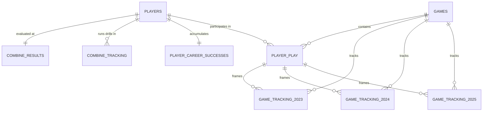

# Official Data Description, File Catalog, and Complete Column Dictionary

---

## 1. Overview of Datasets

The competition dataset contains high-frequency optical tracking, standardized physical testing results, and multi-season NFL game performance metrics for **510 rookie prospects** drafted or signed between **2023 and 2025**.

The dataset is partitioned into **9 CSV files** (~2.2 GiB total) linking pre-draft physical traits directly to regular-season on-field outcomes.

```
┌──────────────────────────────────────────────────────────────────────────────────────────────────────┐
│                                       DATASET FILE SUMMARY                                           │
├──────────────────────────────┬───────────┬─────────────┬─────────┬───────────────────────────────────┤
│ File Name                    │ Size      │ Rows        │ Columns │ Primary Keys / Description        │
├──────────────────────────────┼───────────┼─────────────┼─────────┼───────────────────────────────────┤
│ players.csv                  │ 47 KiB    │ 510         │ 10      │ nfl_id (Rookie prospect metadata) │
│ combine_results.csv          │ 41 KiB    │ 510         │ 18      │ nfl_id (Combine testing splits)   │
│ combine_tracking.csv         │ 79.9 MiB  │ 463,189     │ 14      │ event_id, nfl_id, time (10 Hz)    │
│ player_career_successes.csv  │ 14 KiB    │ 510         │ 9       │ nfl_id (Career volume & honors)   │
│ player_play.csv              │ 139.3 MiB │ 316,338     │ 64      │ game_id, play_id, nfl_id          │
│ games.csv                    │ 43 KiB    │ 1,002       │ 7       │ game_id (Schedule metadata)       │
│ game_tracking_2023.csv       │ 319.9 MiB │ 1,421,805   │ 12      │ game_id, play_id, nfl_id, time    │
│ game_tracking_2024.csv       │ 684.7 MiB │ 3,042,118   │ 12      │ game_id, play_id, nfl_id, time    │
│ game_tracking_2025.csv       │ 975.2 MiB │ 4,339,021   │ 12      │ game_id, play_id, nfl_id, time    │
└──────────────────────────────┴───────────┴─────────────┴─────────┴───────────────────────────────────┘
```

---

## 2. Entity Relationship Diagram



---

## 3. Detailed Column Definitions by File

---

### File 1: `players.csv`

Contains demographic, collegiate, and draft metadata for the 510 rookie prospects.

| Column Name               |    Data Type     | Example                   | Description                                                                                                                                |
| :------------------------ | :--------------: | :------------------------ | :----------------------------------------------------------------------------------------------------------------------------------------- |
| `nfl_id`                  |     `int64`      | `55867`                   | Unique identifier assigned to each NFL player. Primary key across all tracking and performance tables.                                     |
| `display_name`            |      `str`       | `Will Anderson`           | Player's full legal name as registered with the NFL.                                                                                       |
| `draft_year`              |     `int64`      | `2023`                    | Year the prospect entered the NFL Draft (`2023`, `2024`, or `2025`).                                                                       |
| `nfl_position`            |      `str`       | `DE`                      | Official NFL roster position (e.g., `WR`, `CB`, `T`, `G`, `C`, `DT`, `DE`, `OLB`, `TE`, `SS`, `FS`, `NT`, `DB`, `ILB`, `MLB`, `RB`, `FB`). |
| `birth_date`              |      `str`       | `2001-09-02`              | Player date of birth in `YYYY-MM-DD` format.                                                                                               |
| `college_name`            |      `str`       | `Alabama`                 | College or university where the prospect played prior to entering the draft.                                                               |
| `college_conference`      |      `str`       | `Southeastern Conference` | NCAA athletic conference of the prospect's collegiate team.                                                                                |
| `draft_round`             | `int64` / `null` | `1`                       | Round in which the player was selected (1–7). `null` for Undrafted Free Agents (UDFAs).                                                    |
| `draft_pick_within_round` | `int64` / `null` | `3`                       | Pick number within the specific draft round. `null` for UDFAs.                                                                             |
| `draft_overall_pick`      | `int64` / `null` | `3`                       | Overall pick selection number across the entire draft (1–259+). `null` for UDFAs.                                                          |

---

### File 2: `combine_results.csv`

Contains official anthropometric measurements, standardized physical testing splits, and Next Gen Stats draft grades from the NFL Scouting Combine.

| Column Name                    | Data Type | Example  | Description                                                                            |
| :----------------------------- | :-------: | :------- | :------------------------------------------------------------------------------------- |
| `draft_year`                   |  `int64`  | `2023`   | Year of the Scouting Combine (`2023`, `2024`, `2025`).                                 |
| `nfl_id`                       |  `int64`  | `56040`  | Unique player identifier matching `players.csv`.                                       |
| `combine_position`             |   `str`   | `TE`     | Position group the prospect participated with during Combine drills.                   |
| `combine_height`               | `float64` | `77.875` | Official prospect height measured in inches (e.g., `77.875` = 6'5.875").               |
| `combine_weight`               |  `int64`  | `245`    | Official prospect body weight measured in pounds (lbs).                                |
| `hand_size`                    | `float64` | `10.0`   | Hand span measured from tip of thumb to tip of pinky in inches.                        |
| `arm_length`                   | `float64` | `32.25`  | Arm length measured from acromion to tip of middle finger in inches.                   |
| `wing_span`                    | `float64` | `79.75`  | Total fingertip-to-fingertip wingspan in inches.                                       |
| `ten_yd_split`                 | `float64` | `1.60`   | Official electronic 10-yard split time during the 40-yard dash in seconds.             |
| `forty`                        | `float64` | `4.84`   | Official electronic 40-yard dash time in seconds.                                      |
| `vertical`                     | `float64` | `38.5`   | Standing vertical jump height in inches.                                               |
| `broad_jump`                   | `float64` | `125.0`  | Standing broad jump distance in inches.                                                |
| `three_cone`                   | `float64` | `7.12`   | 3-cone (L-drill) agility time in seconds (contains `null` for drill opt-outs).         |
| `short_shuttle`                | `float64` | `4.25`   | 20-yard short shuttle (5-10-5) agility time in seconds (contains `null` for opt-outs). |
| `bench_reps`                   | `float64` | `22.0`   | Number of 225 lb bench press repetitions completed (contains `null` for opt-outs).     |
| `ngs_athleticism_score`        |  `int64`  | `60`     | Next Gen Stats composite athleticism score (0–100 percentile scale).                   |
| `ngs_college_production_score` | `float64` | `78.2`   | Next Gen Stats college production score based on college statistics.                   |
| `ngs_final_score`              | `float64` | `74.5`   | Next Gen Stats overall prospect score combining athleticism and college production.    |

---

### File 3: `combine_tracking.csv`

Contains 10 Hz high-frequency optical sensor tracking across 6,310 Combine drill attempts, including 40-yard dash sprints and position-specific agility/route drills.

| Column Name   |    Data Type     | Example                   | Description                                                                                                                                                                         |
| :------------ | :--------------: | :------------------------ | :---------------------------------------------------------------------------------------------------------------------------------------------------------------------------------- |
| `draft_year`  |     `int64`      | `2025`                    | Year of Combine testing (`2023`, `2024`, `2025`).                                                                                                                                   |
| `event_id`    |      `str`       | `2025030210...`           | Unique identifier linking all tracking frames within a single continuous drill attempt.                                                                                             |
| `nfl_id`      | `int64` / `null` | `58286`                   | Player identifier matching `players.csv`. For ball, it represents the `nfl_id` for player in given `event_id`.                                                                      |
| `entity_type` |      `str`       | `PLAYER`                  | Entity tracked in the frame: `PLAYER` or `BALL`.                                                                                                                                    |
| `time`        |      `str`       | `2025-03-02T18:56:38.200` | ISO 8601 timestamp for the optical tracking frame (sampled every 0.10 seconds).                                                                                                     |
| `drill_type`  |      `str`       | `SKILL_DRILLS_OL`         | Broad drill category (e.g., `FORTY_YARD_DASH`, `THREE_CONE_DRILL`, `SHORT_SHUTTLE`, `SKILL_DRILLS_WR`, `SKILL_DRILLS_DB`, `SKILL_DRILLS_OL`, `SKILL_DRILLS_DL`, `SKILL_DRILLS_TE`). |
| `drill_name`  |      `str`       | `OL_PULL_DRILL_FOLD...`   | Specific drill name (e.g., `GAUNTLET_DRILL`, `RUN_THE_HOOP_DRILL`, `BACK_PEDAL_AND_TRANSITION_45_DEGREE_REACTION`, `SLOT_STRIKE_ROUTE_LEFT`, `PASS_PRO_MIRROR_DRILL`).              |
| `attempt`     |     `int64`      | `4`                       | Attempt number index for the prospect within the given drill.                                                                                                                       |
| `x`           |    `float64`     | `87.09`                   | Player horizontal position along field length in yards (0-120).                                                                                                                     |
| `y`           |    `float64`     | `22.52`                   | Player vertical position across field width in yards (0-53.33).                                                                                                                     |
| `s`           |    `float64`     | `0.28`                    | Instantaneous player speed in yards per second (yd/s).                                                                                                                              |
| `a`           |    `float64`     | `0.11`                    | Instantaneous player acceleration in yards per second squared (yds / sec^2).                                                                                                        |
| `dis`         |    `float64`     | `0.01`                    | Distance traveled from the previous tracking frame in yards.                                                                                                                        |
| `dir`         |    `float64`     | `126.08`                  | Player motion direction angle in degrees (0-360).                                                                                                                                   |

---

### File 4: `player_career_successes.csv`

Contains cumulative career volume statistics, snap counts, and accolades earned by the 510 prospects during their rookie and subsequent seasons.

| Column Name                  | Data Type | Example | Description                                                                                           |
| :--------------------------- | :-------: | :------ | :---------------------------------------------------------------------------------------------------- |
| `nfl_id`                     |  `int64`  | `55867` | Unique player identifier matching `players.csv`.                                                      |
| `career_offensive_snaps`     |  `int64`  | `0`     | Cumulative career offensive snaps played across regular-season and playoff games.                     |
| `career_defensive_snaps`     |  `int64`  | `1884`  | Cumulative career defensive snaps played across regular-season and playoff games.                     |
| `career_special_teams_snaps` |  `int64`  | `92`    | Cumulative career special teams snaps played.                                                         |
| `career_games_active`        |  `int64`  | `51`    | Total number of regular-season games the player was on the active roster.                             |
| `career_games_started`       |  `int64`  | `44`    | Total number of regular-season games started by the player.                                           |
| `ap_all_pro_1st_team`        |  `int64`  | `1`     | Total number of Associated Press (AP) First-Team All-Pro selections earned in career.                 |
| `ap_all_pro_2nd_team`        |  `int64`  | `0`     | Total number of Associated Press (AP) Second-Team All-Pro selections earned in career.                |
| `pro_bowl_original_ballot`   |  `int64`  | `1`     | Total number of Pro Bowl selections on the original ballot (excluding alternate injury replacements). |

---

### File 5: `player_play.csv`

Contains granular in-game Next Gen Stats and play-by-play metrics for every snap involving the rookie cohort across the 2023, 2024, and 2025 seasons ($N=316,338$ player-play records).

#### A. Play Context & Identifiers

| Column Name              | Data Type | Example                     | Description                                                                                                                     |
| :----------------------- | :-------: | :-------------------------- | :------------------------------------------------------------------------------------------------------------------------------ |
| `game_id`                |  `int64`  | `2023091801`                | Unique 10-digit game identifier matching `games.csv`.                                                                           |
| `play_id`                |  `int64`  | `56`                        | Unique play identifier within the game.                                                                                         |
| `team_abbr`              |   `str`   | `BAL`                       | 3-letter abbreviation of the team the player is on.                                                                             |
| `nfl_id`                 |  `int64`  | `55976`                     | Unique player identifier matching `players.csv`.                                                                                |
| `lined_up_position`      |   `str`   | `T`                         | Position where the player aligned on this specific play (e.g., `WR`, `CB`, `T`, `G`, `C`, `DE`, `DT`, `TE`, `FS`, `SS`, `OLB`). |
| `play_description`       |   `str`   | `(15:00) P.Mahomes pass...` | Official textual play-by-play description of the play.                                                                          |
| `quarter`                |  `int64`  | `1`                         | Quarter of the game (1, 2, 3, 4, or 5 for overtime).                                                                            |
| `down`                   |  `int64`  | `1`                         | Current down (1, 2, 3, 4).                                                                                                      |
| `yards_to_go`            |  `int64`  | `10`                        | Yards needed to achieve a first down or touchdown.                                                                              |
| `possession_team`        |   `str`   | `CLE`                       | 3-letter abbreviation of the offensive team.                                                                                    |
| `yardline_side`          |   `str`   | `CLE`                       | 3-letter abbreviation of the team side of the field where the ball is spotted.                                                  |
| `yardline_number`        |  `int64`  | `25`                        | Distance in yards to the nearest goal line ($1 \le \text{yardline} \le 50$).                                                    |
| `game_clock`             |   `str`   | `15:00`                     | Game clock remaining in the quarter in `MM:SS` format.                                                                          |
| `pre_snap_home_score`    |  `int64`  | `0`                         | Home team score prior to the snap.                                                                                              |
| `pre_snap_visitor_score` |  `int64`  | `0`                         | Visiting team score prior to the snap.                                                                                          |
| `play_direction`         |   `str`   | `left`                      | Direction of offensive play progression (`left` or `right`).                                                                    |

#### B. Win Probability & Expected Points

| Column Name                             | Data Type | Example   | Description                                                       |
| :-------------------------------------- | :-------: | :-------- | :---------------------------------------------------------------- |
| `pre_snap_home_team_win_probability`    | `float64` | `0.4237`  | Home team estimated win probability prior to snap.                |
| `pre_snap_visitor_team_win_probability` | `float64` | `0.5763`  | Visiting team estimated win probability prior to snap.            |
| `home_team_win_probability_added`       | `float64` | `0.2210`  | Change in home team win probability produced by the play.         |
| `visitor_team_win_probility_added`      | `float64` | `-0.2210` | Change in visiting team win probability produced by the play.     |
| `expected_points_added`                 | `float64` | `-8.459`  | Net Expected Points Added (EPA) generated on the play.            |
| `expected_points`                       | `float64` | `1.459`   | Expected points value of the offensive drive state prior to snap. |

#### C. Schemes, Formations & Play Results

| Column Name                 | Data Type | Example         | Description                                                                                                                 |
| :-------------------------- | :-------: | :-------------- | :-------------------------------------------------------------------------------------------------------------------------- |
| `offense_formation`         |   `str`   | `EMPTY`         | Offensive pre-snap personnel formation (e.g., `SHOTGUN`, `SINGLEBACK`, `EMPTY`, `I_FORM`, `PISTOL`, `JUMBO`).               |
| `receiver_alignment`        |   `str`   | `3x2`           | Wide receiver alignment distribution (e.g., `3x1`, `2x2`, `3x2`, `1x1`, `4x1`).                                             |
| `pass_result`               |   `str`   | `IN`            | Outcome of the pass play: `C` (Complete), `I` (Incomplete), `S` (Sack), `IN` (Interception), `R` (Scramble).                |
| `pass_length`               | `float64` | `5.0`           | Air yards traveled by the pass past the line of scrimmage (negative for passes behind the LOS).                             |
| `play_nullified_by_penalty` |   `str`   | `N`             | `Y` if the play outcome was wiped out by penalty, `N` otherwise.                                                            |
| `penalty_yards`             | `float64` | `null`          | Total penalty yardage enforced on the play.                                                                                 |
| `pre_penalty_yards_gained`  |  `int64`  | `0`             | Gross yards gained before penalty assessment.                                                                               |
| `yards_gained`              |  `int64`  | `0`             | Official net yards gained on the play.                                                                                      |
| `team_coverage_man_zone`    |   `str`   | `ZONE_COVERAGE` | Primary defensive coverage scheme classification (`MAN_COVERAGE`, `ZONE_COVERAGE`).                                         |
| `team_coverage_type`        |   `str`   | `COVER_6_ZONE`  | Specific defensive coverage shell (e.g., `COVER_1`, `COVER_2`, `COVER_3`, `COVER_4`, `COVER_6_ZONE`, `COVER_0`, `PREVENT`). |
| `in_motion_at_ball_snap`    |  `bool`   | `False`         | True if the player was in active pre-snap motion when the ball was snapped.                                                 |

#### D. Receiver & Ball Carrier Metrics

| Column Name                  | Data Type | Example | Description                                                                                                                     |
| :--------------------------- | :-------: | :------ | :------------------------------------------------------------------------------------------------------------------------------ |
| `target`                     |  `bool`   | `False` | True if the player was the intended target of the pass.                                                                         |
| `rec_yards`                  | `float64` | `14.0`  | Receiving yards gained by the player on the play.                                                                               |
| `rush_yards`                 | `float64` | `null`  | Rushing yards gained by the player on the play.                                                                                 |
| `yards_after_catch`          | `float64` | `6.2`   | Yards gained by the receiver after securing the catch (YAC).                                                                    |
| `fumble`                     | `float64` | `0.0`   | `1.0` if the player fumbled the ball on the play, `0.0` otherwise.                                                              |
| `fumble_lost`                | `float64` | `0.0`   | `1.0` if the player's fumble was recovered by the opponent.                                                                     |
| `route_ran`                  |   `str`   | `SLANT` | Specific route run by the receiver (e.g., `GO`, `OUT`, `SLANT`, `CROSS`, `POST`, `CORNER`, `HITCH`, `SCREEN`, `FLAT`, `WHEEL`). |
| `separation_at_pass_forward` | `float64` | `2.84`  | Distance in yards to the nearest defender at the moment the ball is thrown forward.                                             |
| `cushion`                    | `float64` | `6.15`  | Pre-snap distance in yards between the receiver and their primary coverage defender.                                            |
| `expected_yards_after_catch` | `float64` | `4.1`   | Next Gen Stats expected yards after catch model prediction at catch moment.                                                     |

#### E. Offensive Line & Pass Protection Metrics

| Column Name                         | Data Type | Example  | Description                                                                   |
| :---------------------------------- | :-------: | :------- | :---------------------------------------------------------------------------- |
| `dropback_duration`                 | `float64` | `1.835`  | Time from snap to pass release, sack, or pressure in seconds.                 |
| `extended_sack_allowed`             | `float64` | `0.0`    | Sacks allowed on extended dropbacks exceeding 4.0 seconds.                    |
| `pass_rushers_encountered`          | `float64` | `1.0`    | Number of distinct pass rushers engaged by the offensive lineman on the play. |
| `peak_pressure_probability_allowed` | `float64` | `0.1975` | Peak estimated pressure probability allowed by the offensive lineman.         |
| `pressure_allowed`                  |  `bool`   | `False`  | True if the offensive lineman allowed a pressure (QB hurry, hit, or sack).    |
| `sack_allowed`                      | `float64` | `0.0`    | Sacks charged to the offensive lineman (1.0 for solo, 0.5 for shared).        |
| `time_to_pressure_allowed`          | `float64` | `2.45`   | Time in seconds from snap until the offensive lineman allowed pressure.       |

#### F. Defensive Pass Rush & Tackle Metrics

| Column Name                   | Data Type | Example | Description                                                                                       |
| :---------------------------- | :-------: | :------ | :------------------------------------------------------------------------------------------------ |
| `blitzing`                    |  `bool`   | `False` | True if the defender was rushing the passer on a blitz.                                           |
| `player_get_off`              | `float64` | `0.742` | Time in seconds from ball snap until defensive rusher moves forward across the line of scrimmage. |
| `sack`                        | `float64` | `1.0`   | `1.0` if the defender recorded a sack on the play (`0.5` for shared sack).                        |
| `tackle`                      | `float64` | `1.0`   | `1.0` if the defender made a solo tackle on the ball carrier.                                     |
| `assist`                      | `float64` | `0.0`   | `1.0` if the defender assisted on a tackle.                                                       |
| `caused_forced_fumble`        | `float64` | `0.0`   | `1.0` if the defender forced a fumble on the play.                                                |
| `recovered_fumble`            | `float64` | `0.0`   | `1.0` if the player recovered a loose fumble.                                                     |
| `tackle_for_loss`             | `float64` | `1.0`   | `1.0` if the tackle stopped the play behind the line of scrimmage for negative yards.             |
| `time_to_pressure`            | `float64` | `2.18`  | Time elapsed from snap until this defender generated pressure on the quarterback.                 |
| `time_to_qb_hurry`            | `float64` | `2.80`  | Time elapsed from snap until this defender forced a QB hurry.                                     |
| `coverage_assignment`         |   `str`   | `MAN`   | Pre-snap coverage assignment (e.g., `MAN`, `DEEP_THIRD`, `FLAT`, `HOOK_CURL`).                    |
| `coverage_assignment_at_snap` |   `str`   | `MAN`   | Coverage responsibility updated at ball snap following pre-snap motion.                           |
| `quick_pressure`              | `float64` | `null`  | `1.0` if a pass rusher pressures within 2.50 seconds of the snap.                                 |
| `unblocked_pressure`          | `float64` | `null`  | `1.0` if a pass rusher pressured the QB through this lineman's gap without being blocked.         |

---

### File 6: `games.csv`

Contains schedule, season, and team matchup metadata for all 1,002 NFL regular-season and playoff games across 2023, 2024, and 2025.

| Column Name         | Data Type | Example      | Description                                                      |
| :------------------ | :-------: | :----------- | :--------------------------------------------------------------- |
| `game_id`           |  `int64`  | `2023090700` | Unique 10-digit NFL game identifier (`YYYYMMDD##`). Primary key. |
| `game_key`          |  `int64`  | `59173`      | Historical NFL game key identifier.                              |
| `season`            |  `int64`  | `2023`       | NFL season year (`2023`, `2024`, `2025`).                        |
| `season_type`       |   `str`   | `REG`        | Type of season: `REG` (Regular Season) or `POST` (Playoffs).     |
| `week`              |  `int64`  | `1`          | Week number within the season (Weeks 1–18).                      |
| `home_team_abbr`    |   `str`   | `KC`         | 3-letter abbreviation of the home team.                          |
| `visitor_team_abbr` |   `str`   | `DET`        | 3-letter abbreviation of the visiting team.                      |

---

### Files 7, 8, 9: `game_tracking_2023.csv`, `game_tracking_2024.csv`, `game_tracking_2025.csv`

Contain 10 Hz high-frequency in-game optical tracking frames for all rookie cohort prospects across each respective NFL season.

| Column Name |   Data Type    | Example                   | Description                                                                                                                                                               |
| :---------- | :------------: | :------------------------ | :------------------------------------------------------------------------------------------------------------------------------------------------------------------------ |
| `game_id`   |    `int64`     | `2024080952`              | Game identifier matching `games.csv`.                                                                                                                                     |
| `play_id`   |    `int64`     | `3379`                    | Play identifier matching `player_play.csv`.                                                                                                                               |
| `nfl_id`    |    `int64`     | `57367`                   | Player identifier matching `players.csv` (tracks all 510 rookie cohort prospects).                                                                                        |
| `time`      |     `str`      | `2024-08-10T01:30:31.800` | ISO 8601 timestamp for the in-game optical tracking frame (sampled every 0.10s).                                                                                          |
| `x`         |   `float64`    | `87.09`                   | Player horizontal position along field length in yards (0-120).                                                                                                           |
| `y`         |   `float64`    | `22.52`                   | Player vertical position across field width in yards (0-53.33).                                                                                                           |
| `s`         |   `float64`    | `0.28`                    | Instantaneous player speed in yards per second (yd/s).                                                                                                                    |
| `a`         |   `float64`    | `0.11`                    | Instantaneous player acceleration in yards per second squared (yds / sec^2).                                                                                              |
| `dis`       |   `float64`    | `0.03`                    | Distance traveled from the previous tracking frame in yards.                                                                                                              |
| `o`         |   `float64`    | `98.51`                   | Player body orientation angle in degrees (0-360).                                                                                                                         |
| `dir`       |   `float64`    | `126.08`                  | Player motion direction angle in degrees (0-360).                                                                                                                         |
| `event`     | `str` / `null` | `pass_forward`            | Game play milestone event tag (e.g., `ball_snap`, `pass_forward`, `pass_arrived`, `tackle`, `touchdown`, `first_contact`, `out_of_bounds`, or `null` for regular frames). |


